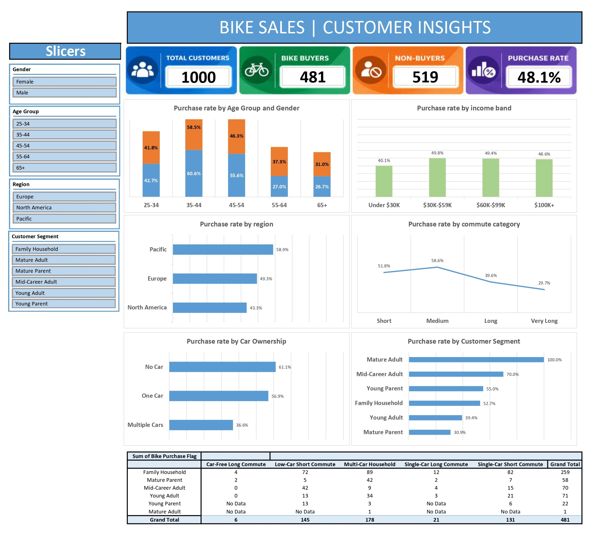

# Bike Sales \| Customer Insights Dashboard

An interactive Excel dashboard built to explore customer bike-purchasing
behavior. The project combines data cleaning, feature engineering,
PivotTables, charts, KPI cards, and slicers to help identify which
customer groups have higher or lower bike-purchase rates.

> **Project type:** Excel Data Analytics Portfolio Project\
> **Tools:** Microsoft Excel, Power Query, PivotTables, PivotCharts,
> slicers, conditional formatting\
> **Dataset size:** 1,000 customer records\
> **Dashboard status:** Interactive dashboard with slicers

------------------------------------------------------------------------

## Table of Contents

-   [Business Objective](#business-objective)
-   [Dashboard Preview](#dashboard-preview)
-   [Key Metrics](#key-metrics)
-   [Questions Explored](#questions-explored)
-   [Key Findings](#key-findings)
-   [Data Preparation](#data-preparation)
-   [Dashboard Features](#dashboard-features)
-   [Workbook Structure](#workbook-structure)
-   [How to Use](#how-to-use)
-   [Limitations and Interpretation](#limitations-and-interpretation)
-   [Future Improvements](#future-improvements)
-   [Author](#author)

------------------------------------------------------------------------

## Business Objective

The objective is to analyze customer characteristics and identify
patterns associated with bike purchasing.

The dashboard is designed to help answer questions such as:

-   Which age groups have the highest bike-purchase rates?
-   Does purchase behavior vary by income band?
-   Which regions have higher purchase rates?
-   How is purchase behavior associated with commute distance?
-   Does car ownership correspond with different purchase rates?
-   Which customer segments show stronger purchase behavior?
-   How do customer segment and mobility profile combine?

The analysis is descriptive. It highlights relationships in the
available dataset; it does not establish that any customer
characteristic causes a purchase.

## Dashboard Preview

Add a screenshot of the final dashboard to the repository, for example
at `images/dashboard_preview.jpg`, then uncomment the line below:

The Excel workbook is the interactive version. A PDF export can be
included as a convenient static preview, but PDF exports do not preserve
slicer interaction.

## Key Metrics

The dashboard's overall figures, before applying slicers, are:

| KPI | Value |
|---|---:|
| Total customers | 1,000 |
| Bike buyers | 481 |
| Non-buyers | 519 |
| Purchase rate | 48.1% |

**Definitions**

-   **Total customers:** Number of customer records included in the
    analysis.
-   **Bike buyers:** Customers whose `Purchased Bike` value indicates a
    purchase.
-   **Non-buyers:** Total customers minus bike buyers.
-   **Purchase rate:** Bike buyers divided by total customers.

The overall figures reconcile: 481 buyers + 519 non-buyers = 1,000
customers.

## Questions Explored

The dashboard includes views for:

1.  **Age group and gender** --- compares purchase rates across age
    groups and gender.
2.  **Income band** --- compares purchase rates across income ranges.
3.  **Region** --- compares purchase rates across geographic regions.
4.  **Commute category** --- compares purchase rates for short, medium,
    long, and very long commutes.
5.  **Car ownership** --- compares purchase rates for customers with no
    car, one car, or multiple cars.
6.  **Customer segment** --- compares purchase rates across engineered
    customer segments.
7.  **Customer segment and mobility profile** --- explores combinations
    of household/customer segments and mobility characteristics using a
    PivotTable.

## Key Findings

The following figures are visible in the current dashboard export and
describe the full dataset before slicer selections:

-   **Pacific has the highest regional purchase rate** at 58.9%,
    followed by Europe at 49.3% and North America at 43.3%.
-   **Customers with no car have a 61.1% purchase rate**, compared with
    56.9% for customers with one car and 36.6% for customers with
    multiple cars.
-   **Medium-commute customers have the highest displayed
    commute-category purchase rate** at 58.6%. The displayed rate is
    51.8% for short commutes, 39.6% for long commutes, and 29.7% for
    very long commutes.
-   **Mid-Career Adults have a 70.0% purchase rate** (70 buyers out of
    100 customers in the cleaned dataset).
-   The displayed income-band purchase rates are 40.1% for Under \$30K,
    49.8% for \$30K--\$59K, 49.4% for \$60K--\$99K, and 48.6% for
    \$100K+.

### Important sample-size caution

The `Mature Adult` segment displays a 100% purchase rate, but it
contains only **one customer** in this dataset. That rate should not be
interpreted as a reliable segment-level pattern. Always consider the
customer count alongside a purchase rate.

The bottom PivotTable in the current dashboard displays **buyer counts**
by customer segment and mobility profile. Counts are not purchase rates:
a group may have more buyers simply because it contains more customers.
To compare purchasing likelihood fairly, divide buyers by the total
customers in each corresponding group.

These findings are descriptive and do not demonstrate causation.

## Data Preparation

The dataset was prepared using Power Query in Excel. The preparation
steps include:

-   Promoting the source row to column headers and assigning data types.
-   Removing duplicate records.
-   Standardizing marital-status and gender labels.
-   Converting income to a currency-compatible numeric type.
-   Standardizing home-owner and bike-purchase fields as logical values.
-   Creating an integer `Bike Purchase Flag` (`1` for buyer, `0` for
    non-buyer).
-   Creating analytical fields to support segmentation and sorting.

### Engineered columns

The cleaned data includes additional fields such as:

-   `Age Group` and `Age Group Sort`
-   `Income Band` and `Income Band Sort`
-   `Car Ownership Category`
-   `Parent Status`
-   `Family Size Group`
-   `Commute Category` and `Commute Distance Sort`
-   `Education Sort`
-   `Mobility Profile`
-   `Customer Segment`
-   `Bike Purchase Flag`

The income-band thresholds used in the workbook are Under \$30K,
\$30K--\$59K, \$60K--\$99K, and \$100K+. The original dataset's currency
context should be confirmed before interpreting these as a specific
currency.

## Dashboard Features

-   Four KPI cards for total customers, bike buyers, non-buyers, and
    purchase rate.
-   Interactive slicers for gender, age group, region, and customer
    segment.
-   Charts comparing purchase rates across demographic and mobility
    groups.
-   A PivotTable for buyer counts by customer segment and mobility
    profile.
-   Consistent color coding and conditional formatting to support quick
    comparisons.

The dashboard is designed so users can filter the data and explore how
the displayed results change. The PDF preview is static; use the Excel
workbook to interact with the slicers.

## Workbook Structure

The workbook currently uses these sheets:

| Sheet | Purpose |
|---|---|
| `cleaned_data` | Cleaned customer data and engineered columns |
| `pivot_tables` | Supporting PivotTables used by dashboard visuals and KPIs |
| `dashboard` | Interactive dashboard, KPI cards, charts, and slicers |

## How to Use

1.  Download or clone this repository.
2.  Open the Excel workbook in desktop Microsoft Excel.
3.  Enable editing if prompted.
4.  Use the slicers on the dashboard to filter by gender, age group,
    region, or customer segment.
5.  Observe how the KPI cards and connected visuals respond to the
    selected filters.
6.  Clear slicer filters to return to the full-dataset view.

If the source data is updated, refresh Power Query and then refresh the
PivotTables. Confirm that slicers remain connected to the intended
PivotTables after changes.

## Limitations and Interpretation

-   The dataset contains 1,000 customer records; patterns may not
    generalize to other populations or time periods.
-   The dashboard describes associations, not causal effects.
-   Small segments can produce extreme purchase rates. Always inspect
    sample sizes.
-   Buyer counts and purchase rates answer different questions and
    should not be confused.
-   Income-band labels use thresholds in the workbook; verify the source
    currency before making currency-specific claims.
-   The PDF export is not interactive.
-   The source data and workbook should be reviewed for licensing and
    redistribution conditions before publishing them publicly.

## Future Improvements

Potential next steps:

-   Add customer counts alongside purchase rates to make sample sizes
    visible.
-   Use a minimum-sample-size rule or warning for very small groups.
-   Compare purchase rates across multiple dimensions, such as region ×
    car ownership or age group × commute category.
-   Add a short executive summary with the most actionable findings.
-   Improve chart readability for smaller screens and exported PDFs.
-   Add a data-validation checklist to confirm totals and purchase flags
    reconcile after refresh.
-   Include a data dictionary documenting each source and engineered
    field.

## Author

Created as an Excel data analytics portfolio project demonstrating data
preparation, feature engineering, PivotTable analysis, interactive
dashboard design, and business interpretation.

------------------------------------------------------------------------

*If you find an issue or have a suggestion, feel free to open an issue
or propose an improvement.*
